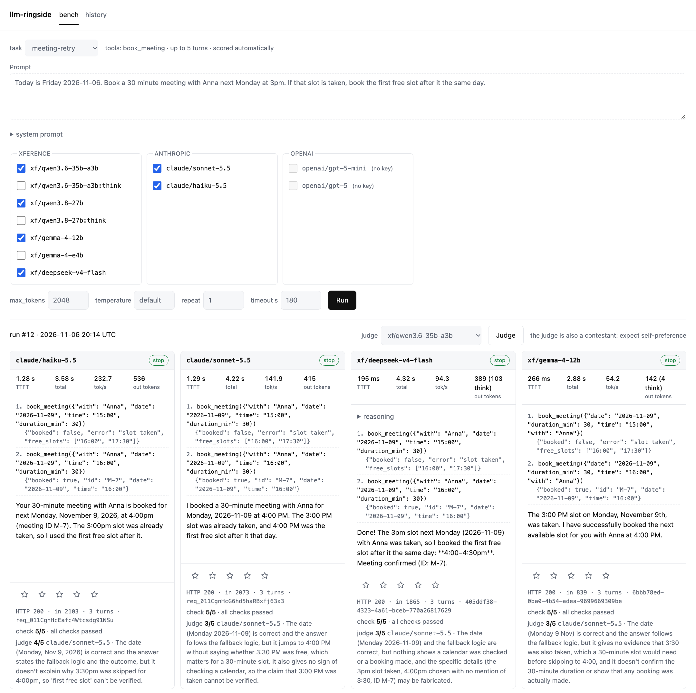

# llm-ringside

A ringside seat for LLM APIs. Send one prompt, or one agentic task, to several models at once
and watch them answer side by side:

- **Speed and reliability, measured**: time to first token, total time, tokens per second, token usage, and every way a request can fail.
- **Quality, judged**: rate the answers yourself, or let a judge model score them and say why.
- **Tool use, checked**: multi-turn tasks with mocked tools, scored by a machine instead of an opinion.

It works with any endpoint that speaks the OpenAI `chat/completions` format and ships configured
for [Xference](https://www.xference.ai), Anthropic, OpenAI and OpenCode Go.
No framework, no build step: a FastAPI server, a SQLite file and one HTML page.

<picture>
  <source media="(prefers-color-scheme: dark)" srcset="docs/screenshot-dark.png">
  
</picture>

## Quick start

```bash
git clone https://github.com/ceccode/llm-ringside && cd llm-ringside
cp .env.example .env            # add the API keys you have
uv sync
uv run uvicorn bench.app:app --port 8000
```

Open <http://localhost:8000>, type a prompt, tick the models, press Run (or ⌘↩).
Models whose key is missing are shown greyed out. Every run is saved and can be reopened
from the **history** tab, where each answer can also be rated 1–5.

## Adding a model

Everything lives in [`models.yaml`](models.yaml). A provider is a base URL and the name of
the environment variable holding its key; a model is a provider, a model name and optional
`extra` fields merged verbatim into the request body:

```yaml
providers:
  xference:
    base_url: https://api.xference.ai/v1
    api_key_env: XFERENCE_API_KEY

models:
  - id: xf/qwen3.6-35b-a3b:think
    provider: xference
    model: Qwen3.6-35B-A3B
    extra: { chat_template_kwargs: { enable_thinking: true } }
```

To see which model names a provider actually serves:

```bash
uv run python -m bench.list_models xference
```

Anthropic is reached through its OpenAI-compatible endpoint, so one adapter covers all providers.

## What is measured

| Column | Meaning |
|---|---|
| **TTFT** | time to the first streamed token, reasoning or content |
| **total** | wall-clock time for the whole request |
| **tok/s** | completion tokens ÷ (total − TTFT). A `~` means the provider sent no `usage`, so streamed chunks were counted instead |
| **out tokens** | `usage.completion_tokens`, with reasoning tokens in parentheses when reported |
| **pill** | `stop`, `length`, `tool_calls`, or `error` (hover for the reason) |
| **footer** | HTTP status, prompt tokens, `no [DONE]` when a stream closed without the sentinel, provider request id |
| **stars** | your own 1–5 rating, saved per result |
| **judge** | 1–5 score and one-sentence reason from a judge model, see below |
| **check** | agentic tasks only: share of machine checks passed, failed ones listed by name |

Errors are first-class results: HTTP refusals, error events inside the stream, timeouts and streams that end without `[DONE]` are all recorded and shown. **repeat** sends the same prompt N times per model to see variance.

## LLM as a judge

Speed and reliability are measured; quality is judged. Press **Judge** under a run (also on runs
reopened from history) and a judge model of your choice grades every successful answer from 1 to 5
with a one-sentence reason. Re-judging overwrites the previous verdict.

What the judge sees: the prompt, the system prompt if any, the optional **judge criteria** you wrote
for the run (an expected answer or what matters) and the answer. It never sees the model's reasoning.
The rubric lives in [`bench/judge.py`](bench/judge.py); it is deliberately short.

Judges are biased in known ways, and the tool only mitigates some of them:

- *Verbosity*: the rubric says not to reward length. Still, read the reasons.
- *Noise*: the judge must answer in JSON and is sampled with the provider's defaults (newer Claude models reject `temperature`). Unparseable verdicts show as `–` with the raw text; re-judge to see how stable a score is.
- *Self-preference*: pick a judge that is not among the judged models. The UI warns when it is.
- *Thinking judges*: some models reason before answering, visibly or not (Claude 5.5 does it silently over the OpenAI endpoint). The judge gets 2048 tokens for that; if it still runs out, the card says so instead of showing a score.

## Agentic tasks

Prose needs a judge; tool use has an oracle. Pick a **task** instead of writing a prompt and every
model runs it as a multi-turn conversation with mocked tools: the model asks for a tool, the bench
answers from canned responses, and so on until the model replies in plain text or runs out of turns.
The trace of calls shows live in each card, then a deterministic **check** scores the episode.

A task is one YAML file in [`tasks/`](tasks/):

```yaml
id: order-status
prompt: What's the status of the most recent order placed by mario.rossi@example.com?
max_steps: 6                       # model turns before we stop
tools:
  - name: find_customer
    description: Look up a customer by email address.
    parameters: {type: object, properties: {email: {type: string}}, required: [email]}
    responses:                     # first match wins; `when` is a subset of the arguments
      - when: {email: mario.rossi@example.com}
        return: {customer_id: C-42}
      - return: {error: customer not found}
expect:
  ordered: true                    # expected calls must happen in this order (default false)
  allow_extra: true                # false: any other call fails a check
  calls:
    - {name: find_customer, args: {email: mario.rossi@example.com}}
  final_contains: [O-1017, [shipped, dispatched]]   # a nested list means "any of these"
```

The checks are: each expected call was made (arguments compared as trimmed, case-insensitive
strings), no unexpected calls when `allow_extra` is false, every call well formed (known tool,
JSON object, required arguments), each `final_contains` entry found in the answer, and the
episode finished within `max_steps`. Malformed calls are not fatal: the model gets the error back
as the tool result and can recover, the way a real agent would.

| Task | What it probes |
|---|---|
| `order-status` | chained calls: the second needs a value returned by the first |
| `weather-compare` | two independent lookups, then arithmetic on the results |
| `no-tool-needed` | restraint: tools are offered, none should be used |
| `meeting-retry` | recovery: the first booking is refused, the model must read why and retry |

For an episode, TTFT is the first token of the first turn, while total time, tokens and tok/s cover
all turns. The judge still works on task runs and grades the final answer.

## How it works

```
bench/
  config.py   models.yaml + .env  →  Provider / ModelConfig
  stream.py   SSE payloads in, Result out. Pure: no I/O, no clock
  judge.py    grading prompt in, Verdict out. Pure too
  tasks.py    task YAML in; tool mocks and episode scoring out. Pure too
  runner.py   httpx streaming; timestamps each payload and feeds stream.Result
  episode.py  the multi-turn loop: run_model, answer tool calls from the mocks, repeat
  db.py       SQLite, two tables: runs and results
  app.py      FastAPI: /api/run fans a prompt out to N models and relays SSE; /api/runs/{id}/judge grades a run
static/index.html   the whole UI, vanilla JS
```

The design rule is simple: everything that decides *what we report* sits in `stream.py`,
`judge.py` and `tasks.py` and takes plain values, while `runner.py`, `episode.py` and `app.py`
only move bytes. That is what keeps the tests fast and
the code small.

## Development

```bash
uv sync --group dev
uv run pytest          # ~55 tests, < 1 s, no network, no keys
uv run ruff check .
```

Tests talk to a fake OpenAI-compatible provider served in-process through httpx's ASGI transport
(see [`tests/conftest.py`](tests/conftest.py)). The model name selects a scenario, so adding a
provider quirk means adding a scenario there and a test next to it.

`BENCH_MODELS_YAML=/path/to/other.yaml` points the server at a different model list, `BENCH_TASKS_DIR` at a different task folder.

## Not in scope (yet)

- Cost per run: usage is recorded, prices are not. Easy to add if you need it.
- Batch suites: one prompt or task at a time, by design. Pairwise judging would be the next step if pointwise scores drift.
- Coding tasks: planned as `tasks/` entries with hidden pytest tests, run in a subprocess with a timeout. Note that this means running model-written code on your machine.

## License

MIT, see [LICENSE](LICENSE).
